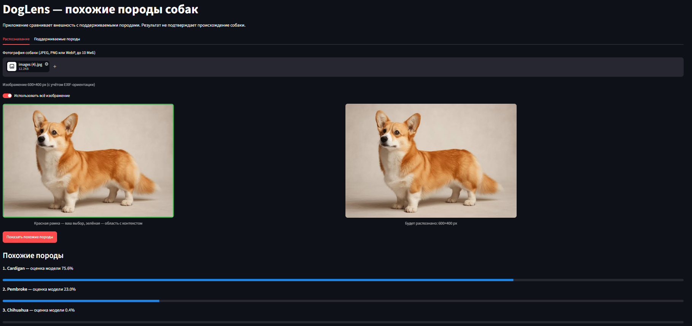
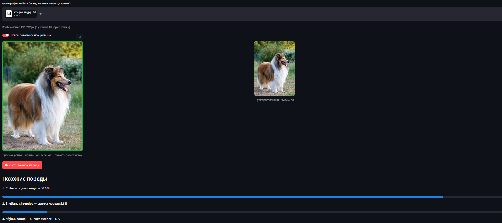
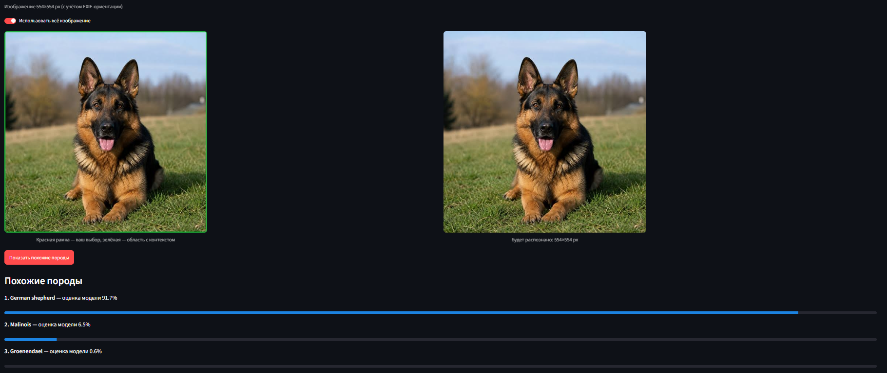
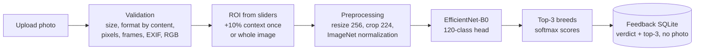

# DogLens

[](https://github.com/7SUNNY77/DogLens/actions/workflows/ci.yml)

[Русский](README.md) · **English**

DogLens suggests the dog breeds that look most similar to the dog in a photo. You upload a photo,
select one dog, and get the top-3 visually similar breeds out of 120 supported breeds
(Stanford Dogs). The app compares appearance only: the result does not confirm a dog's ancestry,
and the scores are not genetic proportions.

The app runs locally on CPU. Its user interface is in Russian.

> Status: **v0.1.0**, a local MVP with a trained model ([release](https://github.com/7SUNNY77/DogLens/releases/tag/v0.1.0)). The clean-copy
> launch and the UI scenario were checked automatically, including in a real headless browser, and
> the owner tried the app in a browser. A systematic external evaluation on new photos has **not**
> been done yet. See [docs/RELEASE_CHECKLIST.md](docs/RELEASE_CHECKLIST.md).

## Features

- 120 supported breeds (Stanford Dogs classes) with a searchable catalog.
- Upload JPEG, PNG or WebP (up to 10 MiB and 20 MP). The format is checked by content, and EXIF
  orientation is applied.
- Choose a region with **two sliders** (horizontal and vertical range) or use the whole image.
  There is no drag-to-draw box.
- Preview of the exact crop sent to the model: your region plus 10% context on each side.
- Top-3 breeds with the model's scores.
- Feedback stored in local SQLite **without** the photo, EXIF/GPS or file name.

## Demo

Screenshots of the app (Russian UI) with example photos supplied by the repository owner,
"use whole image" mode:





These screenshots illustrate the interface. They are not an accuracy measurement.

## Quick start

Requirements, as verified in this project:
- Windows 11 x86_64 with Python 3.11, managed by [uv](https://docs.astral.sh/uv/getting-started/installation/);
- about 1.1 GB of disk space for the environment (measured on Windows);
- no GPU.

Other platforms are expected to work through `uv.lock` but have not been checked.

```bash
uv sync                          # creates .venv from uv.lock
```

**Get the model bundle.** The trained weights are not stored in Git. Download
`doglens-effb0-effb0-seed42-exp1-de6c9770.zip` and `doglens-effb0-effb0-seed42-exp1-de6c9770.zip.sha256` from the [v0.1.0 release assets](https://github.com/7SUNNY77/DogLens/releases/tag/v0.1.0) into the project folder.
The weights have their own terms: [docs/MODEL_TERMS.md](docs/MODEL_TERMS.md).

SHA-256: `13a1612fd6fda27759a239dc8f03f19d32b4c7365d7bbffb3af5551c9849713d`

```bash
uv run python scripts/package_bundle.py verify doglens-effb0-effb0-seed42-exp1-de6c9770.zip --extract-to artifacts
# checks SHA-256, unpacks to artifacts/model_bundle/, loads it and runs an offline inference check
```

Or unpack the archive manually so that `artifacts/model_bundle/` appears. To keep the bundle
elsewhere, set `DOGLENS_BUNDLE_DIR=/path/to/model_bundle`.

```bash
uv run streamlit run app.py      # then open http://localhost:8501
```

The Stanford Dogs dataset is **not** needed to run the app. The app does not download weights or
data at startup or during inference.

## Model results

EfficientNet-B0 (ImageNet-pretrained backbone) with a new 120-class head. The model was selected on
validation only: stage A (frozen backbone), epoch 3. Fine-tuning (stage B) did not improve
validation accuracy.

| Split | Images | Top-1 | Top-3 | Macro F1 (120 labels) |
|---|---|---|---|---|
| Validation | 2,382 | 87.45% | 97.02% | 0.8737 |
| Official Stanford Dogs test | 8,580 | **87.25%** | **98.02%** | **0.8665** |

Read these numbers with care:
- They are measured on **Stanford Dogs**. Stanford Dogs is built from ImageNet images, and the
  backbone was pretrained on ImageNet-1k, so test metrics are likely **optimistic**.
- **No external evaluation** on new user photos has been performed yet
  ([docs/EXTERNAL_VALIDATION.md](docs/EXTERNAL_VALIDATION.md)).
- Scores are softmax outputs over the 120 supported breeds. They are **not calibrated**
  probabilities of a correct answer.

Diagnostic slices, confused breed pairs and the full methodology are in
[docs/MODEL_CARD.md](docs/MODEL_CARD.md).

## Performance

CPU inference, batch size 1, measured on an Intel Core Ultra 7 155H laptop (Windows 11,
torch 2.14.1+cpu, 16 threads), after warm-up, median / p95:

| Input | `predict()` (crop + preprocessing + model) | Decode + `predict()` |
|---|---|---|
| 333×500 photo with a selected region | 24.9 / 31.0 ms | 26.5 / 35.0 ms |
| 4032×3024 synthetic JPEG, whole image | 133 / 148 ms | 191 / 222 ms |

- The model forward alone takes about 20 ms. For large photos most of the time goes to decoding
  and resizing.
- Cold start is separate: importing the libraries takes ~7 s and loading the bundle ~0.3 s.
- Other machines will differ. Details: [docs/DEVELOPMENT.md](docs/DEVELOPMENT.md) and
  `reports/benchmark/`.

## Architecture



- The same `roi.model_region` function produces both the UI crop preview and the model input.
- Only the model is cached per process. Photos, regions and results live in the user's session.

## Development and reproducibility

```bash
uv run pytest                    # default suite: no dataset, bundle, GPU or network needed
uv run pytest -m integration     # real dataset/bundle checks (skipped when absent)
uv run ruff check . && uv run ruff format --check .
```

| Topic | Command / document |
|---|---|
| Data preparation (Stanford Dogs, official split) | `scripts/prepare_dataset.py`, [reports/dataset_preparation.md](reports/dataset_preparation.md) |
| Training (two stages, resume) | `scripts/train.py`, [reports/training_exp1.md](reports/training_exp1.md) |
| Evaluation (test + slices) | `scripts/evaluate.py`, [reports/evaluation/test/summary.md](reports/evaluation/test/summary.md) |
| Bundle export / packaging | `scripts/export_bundle.py`, `scripts/package_bundle.py` |
| Inference benchmark | `scripts/benchmark.py` |
| Checking your own photos | `scripts/check_photos.py`, [docs/EXTERNAL_VALIDATION.md](docs/EXTERNAL_VALIDATION.md) |
| Full developer guide (Russian) | [docs/DEVELOPMENT.md](docs/DEVELOPMENT.md) |

A minimal GitHub Actions workflow ([.github/workflows/ci.yml](.github/workflows/ci.yml)) runs ruff
and the default tests on Ubuntu and Windows.

## Limitations

- The classifier always answers with one of the 120 supported breeds. It has no reliable
  "not a dog" class and cannot tell mixed-breed composition.
- There is no automatic dog detector: select one dog yourself.
- The region is chosen with two sliders, not by dragging a box.
- Breed names are shown in English; no verified Russian translations yet.
- External evaluation on new photos has not been performed; scores are not calibrated.

## Data and pretrained weights

- **Stanford Dogs** (Khosla et al., FGVC Workshop, CVPR 2011) was used for training and evaluation.
  The official page gives citations but no explicit license, and states that the dataset is built
  from ImageNet images. The images are **not** included in or redistributed by this repository.
  The ImageNet terms of access were not re-verified in this project; check them, and the right to
  show any dataset photo, before using such photos in a public demo.
- **Pretrained initialization**: torchvision `EfficientNet_B0_Weights.IMAGENET1K_V1`, used only to
  initialize training and verified by SHA-256 (`data/weights/SOURCE.json`).
- **Trained model weights** (the release bundle) are **not** covered by the MIT license. They are
  offered for non-commercial research and educational use with attribution:
  [docs/MODEL_TERMS.md](docs/MODEL_TERMS.md).

## License

- Source code: [MIT](LICENSE), © 2026 Alexey Obraztcov.
- Trained model weights: separate terms in [docs/MODEL_TERMS.md](docs/MODEL_TERMS.md)
  (non-commercial research/education, attribution, no warranty).
- Stanford Dogs / ImageNet images are not part of this repository, and no license covers them here.
