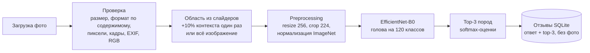

# DogLens

[](https://github.com/7SUNNY77/DogLens/actions/workflows/ci.yml)

**Русский** · [English](README.en.md)

DogLens подбирает породы, на которые собака на фото похожа больше всего. Вы загружаете фото,
выделяете одну собаку и получаете три визуально похожие породы из 120 поддерживаемых
(Stanford Dogs). Приложение сравнивает только внешность: результат не подтверждает
происхождение собаки, а оценки — не генетические доли.

Приложение работает локально на CPU, интерфейс на русском.

> Статус: **v0.1.0**, локальный MVP с обученной моделью ([релиз](https://github.com/7SUNNY77/DogLens/releases/tag/v0.1.0)). Запуск из чистой
> копии и сценарий UI проверены автоматически, в том числе в реальном headless-браузере, а владелец
> опробовал приложение в браузере. Систематической внешней проверки на новых фото **ещё не было**.
> См. [docs/RELEASE_CHECKLIST.md](docs/RELEASE_CHECKLIST.md).

## Возможности

- 120 поддерживаемых пород (классы Stanford Dogs) и каталог с поиском.
- Загрузка JPEG, PNG или WebP (до 10 МиБ и 20 Мпикс). Формат проверяется по содержимому,
  EXIF-ориентация учитывается.
- Выбор области **двумя слайдерами** (диапазон по горизонтали и по вертикали) или всё
  изображение. Рамки, которую можно тянуть мышью, нет.
- Превью точного кропа, который получит модель: ваша область плюс 10% контекста с каждой стороны.
- Top-3 пород с оценками модели.
- Отзывы в локальной SQLite **без** фото, EXIF/GPS и имени файла.

## Демонстрация

Скриншоты приложения с примерами фото, предоставленными владельцем репозитория; режим
«Использовать всё изображение»:


Скриншоты показывают интерфейс и не являются измерением точности.

## Быстрый старт

Требования, проверенные в проекте:
- Windows 11 x86_64 и Python 3.11 через [uv](https://docs.astral.sh/uv/getting-started/installation/);
- около 1,1 ГБ на диске под окружение (замер на Windows);
- GPU не нужен.

На других платформах запуск через `uv.lock` ожидаем, но не проверялся.

```bash
uv sync                          # создаёт .venv по uv.lock
```

**Скачайте model bundle.** Обученные веса не хранятся в Git. Скачайте `doglens-effb0-effb0-seed42-exp1-de6c9770.zip` и
`doglens-effb0-effb0-seed42-exp1-de6c9770.zip.sha256` из [assets релиза v0.1.0](https://github.com/7SUNNY77/DogLens/releases/tag/v0.1.0) в папку проекта. У весов свои условия
использования: [docs/MODEL_TERMS.md](docs/MODEL_TERMS.md).

SHA-256: `13a1612fd6fda27759a239dc8f03f19d32b4c7365d7bbffb3af5551c9849713d`

```bash
uv run python scripts/package_bundle.py verify doglens-effb0-effb0-seed42-exp1-de6c9770.zip --extract-to artifacts
# проверяет SHA-256, распаковывает в artifacts/model_bundle/, загружает и делает inference без сети
```

Можно распаковать и вручную, так чтобы появился `artifacts/model_bundle/`. Для другого
расположения задайте `DOGLENS_BUNDLE_DIR=/путь/к/model_bundle`.

```bash
uv run streamlit run app.py      # затем откройте http://localhost:8501
```

Датасет Stanford Dogs для запуска приложения **не нужен**. При запуске и распознавании ничего не
скачивается.

## Результаты модели

EfficientNet-B0 (backbone предобучен на ImageNet) с новой головой на 120 классов. Модель выбрана
только по validation: этап A (замороженный backbone), эпоха 3. Fine-tuning (этап B) не улучшил
validation.

| Выборка | Изображений | Top-1 | Top-3 | Macro F1 (120 labels) |
|---|---|---|---|---|
| Validation | 2 382 | 87,45% | 97,02% | 0,8737 |
| Официальный test Stanford Dogs | 8 580 | **87,25%** | **98,02%** | **0,8665** |

Как читать эти числа:
- Они получены на **Stanford Dogs**. Этот датасет собран из ImageNet, а backbone предобучен на
  ImageNet-1k, поэтому метрики на test, вероятно, **оптимистичны**.
- **Внешней проверки** на новых фото пользователей пока не было
  ([docs/EXTERNAL_VALIDATION.md](docs/EXTERNAL_VALIDATION.md)).
- Оценки — softmax среди 120 поддерживаемых пород, **не калиброванная** вероятность правильного
  ответа.

Диагностические срезы, путаемые пары пород и методика — в [docs/MODEL_CARD.md](docs/MODEL_CARD.md).

## Производительность

Inference на CPU, batch 1, ноутбук Intel Core Ultra 7 155H (Windows 11, torch 2.14.1+cpu,
16 потоков), после прогрева, медиана / p95:

| Вход | `predict()` (кроп + preprocessing + модель) | Декодирование + `predict()` |
|---|---|---|
| фото 333×500 с выбранной областью | 24,9 / 31,0 мс | 26,5 / 35,0 мс |
| синтетический JPEG 4032×3024, всё изображение | 133 / 148 мс | 191 / 222 мс |

- Сам forward модели — около 20 мс. На больших фото основное время уходит на декодирование и
  уменьшение изображения.
- Холодный старт отдельно: импорт библиотек ~7 с, загрузка bundle ~0,3 с.
- На других машинах значения будут другими. Подробности — [docs/DEVELOPMENT.md](docs/DEVELOPMENT.md)
  и `reports/benchmark/`.

## Архитектура



- Превью кропа в UI и вход модели формирует одна и та же функция `roi.model_region`.
- На процесс кешируется только модель. Фото, область и результат живут в сессии пользователя.

## Разработка и воспроизводимость

```bash
uv run pytest                    # основной набор: без датасета, bundle, GPU и сети
uv run pytest -m integration     # проверки с реальными данными/bundle (skip при отсутствии)
uv run ruff check . && uv run ruff format --check .
```

| Тема | Команда / документ |
|---|---|
| Подготовка данных (Stanford Dogs, официальное разделение) | `scripts/prepare_dataset.py`, [reports/dataset_preparation.md](reports/dataset_preparation.md) |
| Обучение (два этапа, resume) | `scripts/train.py`, [reports/training_exp1.md](reports/training_exp1.md) |
| Оценка (test + срезы) | `scripts/evaluate.py`, [reports/evaluation/test/summary.md](reports/evaluation/test/summary.md) |
| Экспорт и упаковка bundle | `scripts/export_bundle.py`, `scripts/package_bundle.py` |
| Benchmark inference | `scripts/benchmark.py` |
| Проверка своих фото | `scripts/check_photos.py`, [docs/EXTERNAL_VALIDATION.md](docs/EXTERNAL_VALIDATION.md) |
| Полное руководство разработчика | [docs/DEVELOPMENT.md](docs/DEVELOPMENT.md) |

Минимальный workflow GitHub Actions ([.github/workflows/ci.yml](.github/workflows/ci.yml)) запускает
ruff и основные тесты на Ubuntu и Windows.

## Ограничения

- Классификатор всегда выбирает одну из 120 поддерживаемых пород. Надёжного класса
  «не собака» нет, состав метиса он не определяет.
- Автоматического детектора собак нет: собаку выделяете вы.
- Область выбирается двумя слайдерами, а не рамкой перетаскиванием.
- Названия пород показываются по-английски, проверенных русских переводов пока нет.
- Внешней проверки на новых фото не было, оценки не калиброваны.

## Данные и предобученные веса

- **Stanford Dogs** (Khosla et al., FGVC Workshop, CVPR 2011) использован для обучения и оценки.
  На официальной странице есть ссылки для цитирования, но нет явной лицензии; там же сказано, что
  датасет собран из изображений ImageNet. Изображения в репозиторий **не** входят и не
  распространяются. Условия ImageNet в проекте не перепроверялись — проверьте их и права на
  показ конкретных фото до использования фото датасета в публичной демонстрации.
- **Предобученная инициализация**: torchvision `EfficientNet_B0_Weights.IMAGENET1K_V1`, только
  для инициализации обучения, проверена по SHA-256 (`data/weights/SOURCE.json`).
- **Обученные веса** (bundle из релиза) лицензией MIT **не** покрываются. Они доступны для
  некоммерческого исследовательского и учебного использования с атрибуцией:
  [docs/MODEL_TERMS.md](docs/MODEL_TERMS.md).

## Лицензия

- Исходный код: [MIT](LICENSE), © 2026 Alexey Obraztcov.
- Обученные веса модели: отдельные условия в [docs/MODEL_TERMS.md](docs/MODEL_TERMS.md)
  (некоммерческое исследовательское/учебное использование, атрибуция, без гарантий).
- Изображения Stanford Dogs / ImageNet в репозиторий не входят, и никакая лицензия здесь на них не
  распространяется.
